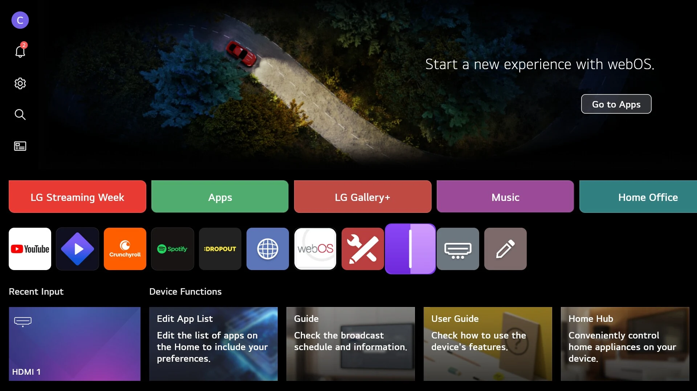
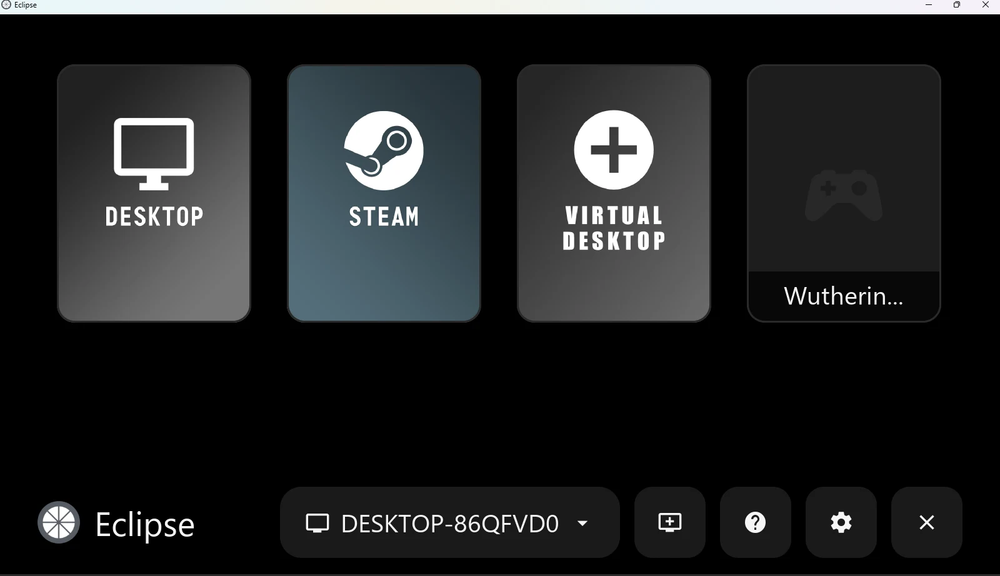
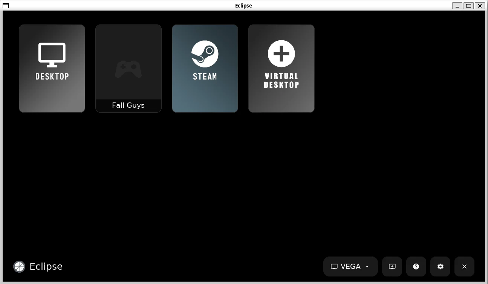
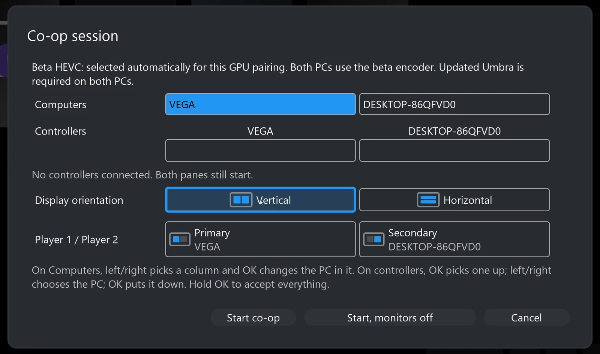

[Project Hub](../README.md) · [Installation Guide](installation.md) · [Eclipse](eclipse.md) · [Umbra](umbra.md) · [Development](development.md) · [Acknowledgements](../ACKNOWLEDGEMENTS.md)

# From download to first stream.

Install Umbra on each gaming PC, then Eclipse on the display device. Start with one working stream before adding the second host.

[Umbra · Windows](#umbra-windows) · [Umbra (Vibepollo) · Windows](#umbra-vibepollo) · [Umbra · Linux](#umbra-linux) · [Eclipse · LG webOS](#eclipse-webos) · [Eclipse · Windows](#eclipse-windows) · [Eclipse · Linux](#eclipse-linux)

<a name="before-you-start"></a>

## Choose the right component.

### Gaming PC → Umbra

Windows x64 or Linux host. Install once for ordinary streaming, or on two PCs for co-op. On Linux, co-op needs KDE Plasma or GNOME on Wayland. The game runs here. Already using Vibepollo? [Umbra (Vibepollo)](#umbra-vibepollo) keeps your settings.

### Screen device → Eclipse

LG webOS, Windows x64 or Linux x86_64 client. Install the package matching the device where you will view and control the stream.

Download an attached file under **Assets**, not GitHub’s automatically generated **Source code (zip)** or **Source code (tar.gz)**. Those are developer archives, not installable apps. Use the latest compatible stable release. If no package is attached for your platform, that download is not available.

[Pairing](#pairing) · [First co-op session](#coop) · [Troubleshooting and logs](#diagnostics) · [Tested hardware](../README.md#status)

<a name="umbra-windows"></a>

## 1A. Umbra on Windows


Umbra’s web interface after setup, showing its version and update checks. Captured on 8 October 2026. [View the full-size panel.](../site/media/umbra-host-home.webp)

[Umbra Windows x64 releases](https://github.com/PreceptorOfMagic/Umbra/releases)

Open the latest release, expand Assets and choose the package described below. If no release is listed, that package has not been published.

**Using Vibepollo?** Install [Umbra (Vibepollo)](#umbra-vibepollo) instead; it keeps your Vibepollo settings. These steps describe the Apollo-based Umbra.

**Package:** the Windows x64 installer `Umbra-windows-x64.exe` attached to an Umbra release, not an Eclipse client ZIP. You need a Windows gaming PC, a supported GPU and current driver, administrator access for installation, and the games you intend to run already installed. Windows 11 x64 is the tested host OS.

1. Open the Umbra release, read its compatibility notes and expand **Assets**. Download the Windows x64 installer and matching checksum if supplied. Compare its SHA-256 hash with `Get-FileHash` in PowerShell before opening it.

1. Back up any existing host configuration and pairings. Umbra replaces Apollo in place, using the same Apollo installation folder and registry identity; installing Apollo again replaces Umbra. Do not expect them to run side by side. If Sunshine is installed separately, stop its service before starting Umbra to avoid competing for network ports or display resources. When upgrading from Apollo or an older Umbra, if setup stops making progress for more than a minute, end `reg.exe` in Task Manager (Details tab) and setup continues.

1. Run the installer and approve the Windows administrator prompt. The installer is unsigned for now, so Windows SmartScreen may warn; check the checksum first, then choose **More info → Run anyway**. Install the bundled virtual-display and controller/device components offered by the installer; there is no separate device-bridge installation step.

1. Allow host access on your trusted private network when Windows asks. Open the host’s web interface using its installed shortcut or tray action, create the local administrator login and review the available game/desktop entries.

1. Keep the client-driven display defaults. Pair Eclipse, approve its PIN in Umbra and test an ordinary Desktop or game session before adding another host.

For co-op, install the same compatible Umbra release on the second Windows PC. Co-op-specific defaults are separate from ordinary streaming settings. The Co-op Pane is built in and requested automatically by Eclipse, rather than created in the host’s editable Applications list. You should not create application entries, copy host IDs or tune encoder settings by hand.

<a name="umbra-vibepollo"></a>

## Umbra (Vibepollo) on Windows

[Umbra (Vibepollo) Windows x64 releases](https://github.com/PreceptorOfMagic/Umbra-Vibepollo/releases)

Open the latest release, expand Assets and choose the package described below. If no release is listed, that package has not been published.

**Package:** the Windows x64 installer `Umbra-Vibepollo-windows-x64.exe` attached to the latest Umbra (Vibepollo) release. It is built on [Vibepollo](https://github.com/Nonary/Vibepollo) instead of Apollo and carries the same additions for Eclipse; [compare the two versions](umbra.md#editions).

1. Download the installer and compare its SHA-256 hash with `Get-FileHash` in PowerShell before opening it. It is unsigned for now, so Windows SmartScreen may warn; check the hash, then choose **More info → Run anyway**.

1. **Installing over Vibepollo keeps your settings.** Umbra (Vibepollo) upgrades a Vibepollo installation in place, the same way Vibepollo upgrades itself: your configuration, applications and paired devices stay. The installer shows **Switch to Umbra (Vibepollo)**. Installing over Apollo or the Apollo-based Umbra also keeps settings and pairings; the installer removes the old program first. Back up your host configuration before switching anyway.

1. Keep the bundled virtual-display and virtual gamepad drivers selected. Until code signing is set up, the gamepad driver is signed with Umbra’s own certificate, which the installer adds to the PC’s trusted certificates.

1. Open the host’s web interface from the Start menu or tray, sign in, pair Eclipse and test an ordinary Desktop stream before co-op. For co-op, install a compatible Umbra on the second PC as well.

1. **Switching back to Vibepollo:** run Vibepollo’s own installer. It replaces Umbra (Vibepollo) in place and keeps the same settings, without the Umbra additions Eclipse uses for co-op.

<a name="umbra-linux"></a>

## 1B. Umbra on Linux

[Umbra for Linux release](https://github.com/PreceptorOfMagic/Umbra/releases/tag/umbra-linux-v0.5.2)

Open the Umbra for Linux release and expand Assets. If no release is listed, that package has not been published.

**Package:** `Umbra-<version>-linux-x86_64.flatpak`, one Flatpak bundle for x86_64 Linux. You need KDE Plasma or GNOME on Wayland (an X11 desktop gives ordinary streaming only), an NVIDIA or AMD GPU with its current driver, and the games you intend to run already installed.

**How far it is tested.** Umbra 0.5.2 for Linux ran on hardware on 2026-10-15, on one PC with an AMD Radeon RX Vega and Secure Boot on: Ubuntu 26.04 and 26.10, Fedora 44 and 45 (pre-release) and openSUSE Tumbleweed, each with KDE Plasma and with GNOME, with the distribution’s own compositor and with its HDR extra. On each it streamed the 4K desktop on its own virtual display, a co-op pane, a co-op disconnect and resume at a new size, and with the extra a co-op pane in 10-bit HDR, checked in the recorded stream. **Not run with 0.5.2:** NVIDIA GPUs (Umbra 0.5.1 was tested on an RTX 2060 SUPER, HDR desktop streams included), an HDR desktop stream (it needs a 10-bit video encoder, which the RX Vega lacks), a co-op session with two hosts, the input setup’s administrator prompt and streamed controller input on the new distributions, and **Arch Linux and CachyOS**: neither can start on the test PC without changing its Secure Boot setup, so both are untested on hardware. On openSUSE Tumbleweed with GNOME, co-op panes ran at about 20 fps on the RX Vega (27 to 39 fps elsewhere); Umbra 0.5.1 measured the same there.

To update from Umbra 0.5.1, install the new bundle as below with `--reinstall` added (`flatpak install --user --reinstall Umbra-<version>-linux-x86_64.flatpak`); settings and pairings are kept. If you installed the earlier Ubuntu `.deb` (Umbra 0.5.0), remove it first with `systemctl --user disable --now sunshine` and `sudo apt remove umbra`. The Flatpak keeps its own settings, so pair Eclipse with it again.

1. Install Flatpak and add Flathub if you have not already (Ubuntu does not include Flatpak by default):

```sh
sudo apt install flatpak
flatpak remote-add --user --if-not-exists flathub https://dl.flathub.org/repo/flathub.flatpakrepo
```

1. Download the `.flatpak` and its `.sha256` from the release’s **Assets** into one folder, check it and install it:

```sh
sha256sum -c Umbra-<version>-linux-x86_64.flatpak.sha256
flatpak install --user Umbra-<version>-linux-x86_64.flatpak
```

1. Flatpak fetches the Freedesktop runtime and, on NVIDIA, the driver extension matching your installed driver. Start **Umbra** from the applications menu.

1. Accept **Input Setup** when it is offered. It installs the input rule that streamed controllers, mouse and keyboard need, through your desktop’s administrator prompt, and can start Umbra whenever you sign in. You can reopen it from the applications menu. If the desktop asks to allow screen sharing, allow it.

1. Open `https://localhost:47990` in a browser on that PC, create the local administrator login and review the game/desktop entries. If a firewall is enabled, allow the host on your trusted private network.

1. Keep the client-driven display defaults. Pair Eclipse, approve its PIN in Umbra and test an ordinary Desktop or game session before adding another host.

| Desktop | Streaming | Own virtual display per stream | Co-op | HDR |
|---|---|---|---|---|
| KDE Plasma 6.6 on Wayland (tested: Ubuntu 26.04, KWin 6.6.6) | Yes | Yes | Yes | With the [KDE HDR extra](#umbra-linux-hdr) |
| KDE Plasma 6.7 on Wayland (tested: Ubuntu 26.10, Fedora 44 and 45, openSUSE Tumbleweed; KWin 6.7.5; Umbra 0.5.2 or newer) | Yes | Yes | Yes | With the [KDE HDR extra](#umbra-linux-hdr) |
| GNOME on Wayland (tested: Ubuntu 26.04 and 26.10, Fedora 44 and 45, openSUSE Tumbleweed; Mutter 50 and 51) | Yes | Yes | Yes | With the [GNOME HDR extra](#umbra-linux-hdr); a physical HDR monitor streams HDR without it |
| X11 desktops (Cinnamon, Xfce, MATE …) | Yes (tested during development on Linux Mint 22.3) | No | No | No |
| Sway, Hyprland and other wlroots desktops, COSMIC | Not supported | | | |

The “Yes” rows were tested on hardware with Umbra 0.5.2 on the RX Vega; “Co-op” there means this PC’s co-op pane, and “HDR” a co-op pane in 10-bit HDR. Other distributions running KDE Plasma or GNOME on Wayland are expected to behave like those rows but have not been tested. KDE Plasma 6.7 needs Umbra 0.5.2: KWin 6.7 announces its outputs through a newer protocol than Umbra 0.5.1 knows, so Umbra 0.5.1 streams the desktop there without a virtual display per stream, co-op or HDR. On KDE with Flatpak 1.18.4 or newer (every distribution above except Ubuntu 26.04), start Umbra once from the application menu before streaming: it then writes the desktop-file entry KDE needs before it lets Umbra create displays. An X11 desktop has no way to create a display while it runs, so there the host streams the desktop but never offers co-op or HDR.

<details>
<summary><strong>Testing in detail: each distribution and desktop, and exactly how it was tested</strong></summary>

Everything below ran on one test PC. The Umbra 0.5.2 tests used its AMD Radeon RX Vega from 2017, with Secure Boot on and each distribution on its own partition, started through its own Microsoft-signed boot loader; the Umbra 0.5.1 NVIDIA tests used an RTX 2060 SUPER in the same PC. The tests themselves are described after the tables.

**Tested in person**

| Distribution | Desktop | Umbra and GPU | How it was tested |
|---|---|---|---|
| Ubuntu 26.04 | KDE Plasma 6.6.6, with the KDE HDR extra | Umbra 0.5.1 development build, AMD Radeon RX Vega (2026-10-14); Umbra 0.5.2 (2026-10-15) | The in-person test. Then the smoke test with Ubuntu's KWin and with the extra `4:6.6.6-0ubuntu0.1+umbrahdr4` |
| Ubuntu 26.04 | GNOME 50.1, with the GNOME HDR extra | Umbra 0.5.1 development builds, AMD Radeon RX Vega and NVIDIA RTX 2060 SUPER (2026-10-14); Umbra 0.5.2 (2026-10-15) | The in-person test (on NVIDIA, an HDR co-op session), with the extra's previous revision. Then the smoke test with Ubuntu's Mutter and with the extra `50.1-0ubuntu2.4+umbrahdr2`, and a memory check: seven back-to-back 290 s HDR co-op streams, gnome-shell's memory flat (the picture moved only in the first 3 minutes) |

**Smoke-tested on hardware (Umbra 0.5.2, AMD Radeon RX Vega, 2026-10-15)**

| Distribution | Desktop | Packages tested | How it was tested |
|---|---|---|---|
| Ubuntu 26.10 | KDE Plasma 6.7.5 | KWin `6.7.5-0ubuntu1`; extra `4:6.7.5-0ubuntu1+umbrahdr1` | The smoke test with each. It ran a 0.5.2 candidate from before the desktop-file fix, with that copy made by hand (the fix itself was tested on Fedora and Tumbleweed). Umbra 0.5.1 was also run: no virtual display, as documented |
| Ubuntu 26.10 | GNOME 51.0 | Mutter `51.0-1ubuntu3`; extra `51.0-1ubuntu3+umbrahdr1` | The smoke test with each |
| Fedora 44 | KDE Plasma 6.7.5 | KWin `6.7.5-1.fc44`; extra `6.7.5-1.fc44.umbrahdr1` | The smoke test with each. On a fresh install, the first start from the application-menu entry wrote the desktop-file copy and offered HDR at once |
| Fedora 44 | GNOME 50.6 | Mutter `50.6-1.fc44`; extra `50.6-1.fc44.umbrahdr2`, built on the test PC | The smoke test with each. Fedora updated Mutter after the release's extras were first built, so the extra was built on the test PC from the same patch; the published one is rebuilt the same way |
| Fedora 45 (pre-release) | KDE Plasma 6.7.5 | KWin `6.7.5-1.fc45`; extra `6.7.5-1.fc45.umbrahdr1` | The smoke test with each; the first start wrote the desktop-file copy |
| Fedora 45 (pre-release) | GNOME 51.1 | Mutter `51.1-1.fc45`; extra `51.1-1.fc45.umbrahdr1`, built on the test PC | The smoke test with each, as for Fedora 44 GNOME. The extra was attached to the release after the others, once Fedora 45's mirrors served the Mutter 51.1 source as well as the package |
| openSUSE Tumbleweed | KDE Plasma 6.7.5 | kwin6 `6.7.5-1.1`; extra `6.7.5-1.1.umbrahdr1` | The smoke test with each; the first start wrote the desktop-file copy |
| openSUSE Tumbleweed | GNOME 50.5 | mutter `50.5-3.1`; extra `50.5-3.1.umbrahdr2` | The smoke test with each. Co-op panes ran at about 20 fps here (27 to 39 fps elsewhere), with or without the extra; Umbra 0.5.1 measured the same |

**Not tested, expected to work (the same packages or versions as a tested row)**

| Distribution | Desktop | Why it should work | HDR extra |
|---|---|---|---|
| Arch Linux | KDE Plasma 6.7.5, GNOME 51 | The same KWin and Mutter releases as the smoke-tested rows. Not run: the test PC cannot start Arch without changing its Secure Boot setup | Automated test only |
| CachyOS | KDE Plasma 6.7.5, GNOME 51 | As Arch; its GNOME uses CachyOS's own Mutter build. Not run, for the same reason | Automated test only |
| Kubuntu, Ubuntu Studio and other Ubuntu 26.04 or 26.10 flavours with KDE | KDE Plasma 6.6 or 6.7 | They install the same KWin packages from Ubuntu's archive as the Ubuntu rows | The Ubuntu KDE extra fits |
| Fedora Kinoite and Silverblue 44, 45 | KDE Plasma 6.7, GNOME | The same KWin and Mutter packages as Fedora | Untested: installing it needs `rpm-ostree`, not the `dnf` command in its README |
| EndeavourOS | KDE Plasma 6.7, GNOME 51 | It uses Arch's own repositories | As Arch |
| Other distributions, for example KDE neon or Manjaro | KDE Plasma 6.6 or 6.7, GNOME 50 or 51, on Wayland | The same desktop versions as tested, in the distribution's own builds | A prebuilt extra fits only if its README's version check passes |

**Unlikely to work, or limited**

| Distribution or desktop | What to expect |
|---|---|
| Debian 13, openSUSE Leap 16.0 | No HDR: their KWin and Mutter are too old for the patches. Umbra itself is untested there |
| Fedora 43 | No HDR: its PipeWire cannot announce HDR capture, and its Mutter 49 has no HDR capture. Umbra itself is untested there |
| X11 desktops (Cinnamon, Xfce, MATE …), for example Linux Mint | Streaming only: no virtual display per stream, co-op or HDR (Linux Mint 22.3 tested during development) |
| Sway, Hyprland and other wlroots desktops, COSMIC (Pop!_OS) | Not supported |

**GPUs.** Umbra 0.5.2 ran only on the AMD Radeon RX Vega. Its encoder limits 4K to about 59 fps and co-op panes to about 35 fps, and it has no 10-bit video encoder, so HDR was tested through co-op panes only. Umbra 0.5.1 was also smoke-tested on an NVIDIA RTX 2060 SUPER (driver 595) on Ubuntu 26.04 with KDE and GNOME, HDR desktop streams included. Intel GPUs and PCs with more than one GPU are untested.

**The tests**

- **In-person test (2026-10-14):** the maintainer used Umbra on the LG TV through Eclipse: a co-op session with the test PC and a Windows Umbra host. It passed; on AMD with the note that the 2017 card's encoder limited how far it could be pushed.
- **Smoke test (2026-10-15):** scripted, with nobody at the PC:
  1. Umbra installed from the bundle with `flatpak install --user`, as in the install steps, and started with the application-menu entry's command. Input Setup was deferred, so its administrator prompt and streamed controllers were not exercised.
  2. A test client on another PC on the network, built on moonlight-common-c (the streaming library Eclipse uses), paired with Umbra and asked for 25-second streams while a moving test window ran on the desktop: the desktop at 3840x2160 and 165 Hz on its own virtual display; the same in HDR (which cannot pass on the RX Vega, as it has no 10-bit video encoder); the co-op pane at 1920x2176, in 8-bit and in 10-bit HDR; the HDR co-op pane recorded and checked (HEVC Main 10 with BT.2020 and PQ tags, a white area at 10-bit brightness of about 576 to 595 where SDR reads 935 to 974, and one frame tone-mapped and looked at); and a co-op disconnect followed by a resume at a new size (2176x1920).
  3. A stream passed when frames arrived, nothing failed and, where asked, HDR was on. Decoded frames were looked at, and no virtual display may remain after the last stream.
  4. Each distribution and desktop ran it twice: with its own compositor, and with its HDR extra installed as its README says (the "ONLY FOR" check, `sha256sum -c`, the install command, a restart, the VERIFY commands).
- **Automated test (every extra, before it is published):** the extra is installed over the distribution's own packages in a clean container of that distribution and checked with its README.txt commands. The patched compositor then runs without a GPU and must offer HDR and 10-bit capture on the virtual display Umbra asks for, as the stock one must not; then the extra is rolled back. No real GPU, display or stream is involved.

</details>

**GPUs.** NVIDIA (tested: RTX 2060 SUPER, driver 595) and AMD (tested: Radeon RX Vega) both encode on the GPU. The only AMD card available for testing is a Radeon RX Vega from 2017: its video encoder reaches about 60 fps at 4K and 165 fps only at 1080p, its co-op panes run at about 35 fps, and it has no 10-bit encoder, so its ordinary streams are SDR. The same card hit the same 4K limit on Windows (62 fps), so its age, not Umbra, is the likely limit; newer AMD cards could not be tested. Intel GPUs and PCs with more than one GPU are untested.

**Co-op.** A Linux host and a Windows host can share one co-op session (tested with Umbra 0.5.0 on Windows). Two Linux hosts together are untested.

<a name="umbra-linux-hdr"></a>

### HDR extras (optional)

**What an extra is.** Umbra streams each virtual display from your desktop's compositor: KWin on KDE Plasma, Mutter on GNOME. Their stock versions only give it SDR. An HDR extra is your distribution's own `kwin` or `mutter` package with one small patch added, which gives those virtual displays HDR and 10-bit capture. It is a separate download because it replaces part of your desktop, which a Flatpak cannot do.

**Umbra detects it by itself.** Once an extra is installed and Umbra restarted (steps below), Umbra offers HDR to Eclipse; there is nothing else to configure. If a distribution update later replaces the extra, Umbra notices at the next stream and streams SDR again until a matching extra is installed.

**Which one you need.** Your distribution and version: `grep -E '^(NAME|VERSION_ID)=' /etc/os-release`. Your desktop: `echo $XDG_CURRENT_DESKTOP` (KDE or GNOME). Each extra fits one exact KWin or Mutter version, named in its `README.txt`; the table shows the series.

**HDR extras in the current Umbra for Linux release:**

| Distribution | KDE Plasma (KWin) | GNOME (Mutter) |
|---|---|---|
| Ubuntu 26.04 | [Umbra-HDR-KDE-ubuntu26.04.tar.gz](https://github.com/PreceptorOfMagic/Umbra/releases/download/umbra-linux-v0.5.2/Umbra-HDR-KDE-ubuntu26.04.tar.gz) ([checksum](https://github.com/PreceptorOfMagic/Umbra/releases/download/umbra-linux-v0.5.2/Umbra-HDR-KDE-ubuntu26.04.tar.gz.sha256)): fits KWin 6.6; Tested in person and smoke-tested | [Umbra-HDR-GNOME-ubuntu26.04.tar.gz](https://github.com/PreceptorOfMagic/Umbra/releases/download/umbra-linux-v0.5.2/Umbra-HDR-GNOME-ubuntu26.04.tar.gz) ([checksum](https://github.com/PreceptorOfMagic/Umbra/releases/download/umbra-linux-v0.5.2/Umbra-HDR-GNOME-ubuntu26.04.tar.gz.sha256)): fits Mutter 50; Tested in person and smoke-tested |
| Ubuntu 26.10 | [Umbra-HDR-KDE-ubuntu26.10.tar.gz](https://github.com/PreceptorOfMagic/Umbra/releases/download/umbra-linux-v0.5.2/Umbra-HDR-KDE-ubuntu26.10.tar.gz) ([checksum](https://github.com/PreceptorOfMagic/Umbra/releases/download/umbra-linux-v0.5.2/Umbra-HDR-KDE-ubuntu26.10.tar.gz.sha256)): fits KWin 6.7; Smoke-tested | [Umbra-HDR-GNOME-ubuntu26.10.tar.gz](https://github.com/PreceptorOfMagic/Umbra/releases/download/umbra-linux-v0.5.2/Umbra-HDR-GNOME-ubuntu26.10.tar.gz) ([checksum](https://github.com/PreceptorOfMagic/Umbra/releases/download/umbra-linux-v0.5.2/Umbra-HDR-GNOME-ubuntu26.10.tar.gz.sha256)): fits Mutter 51; Smoke-tested |
| Fedora 44 | [Umbra-HDR-KDE-fedora44.tar.gz](https://github.com/PreceptorOfMagic/Umbra/releases/download/umbra-linux-v0.5.2/Umbra-HDR-KDE-fedora44.tar.gz) ([checksum](https://github.com/PreceptorOfMagic/Umbra/releases/download/umbra-linux-v0.5.2/Umbra-HDR-KDE-fedora44.tar.gz.sha256)): fits KWin 6.7; Smoke-tested | [Umbra-HDR-GNOME-fedora44.tar.gz](https://github.com/PreceptorOfMagic/Umbra/releases/download/umbra-linux-v0.5.2/Umbra-HDR-GNOME-fedora44.tar.gz) ([checksum](https://github.com/PreceptorOfMagic/Umbra/releases/download/umbra-linux-v0.5.2/Umbra-HDR-GNOME-fedora44.tar.gz.sha256)): fits Mutter 50; Smoke-tested* |
| Fedora 45 (pre-release) | [Umbra-HDR-KDE-fedora45.tar.gz](https://github.com/PreceptorOfMagic/Umbra/releases/download/umbra-linux-v0.5.2/Umbra-HDR-KDE-fedora45.tar.gz) ([checksum](https://github.com/PreceptorOfMagic/Umbra/releases/download/umbra-linux-v0.5.2/Umbra-HDR-KDE-fedora45.tar.gz.sha256)): fits KWin 6.7; Smoke-tested | [Umbra-HDR-GNOME-fedora45.tar.gz](https://github.com/PreceptorOfMagic/Umbra/releases/download/umbra-linux-v0.5.2/Umbra-HDR-GNOME-fedora45.tar.gz) ([checksum](https://github.com/PreceptorOfMagic/Umbra/releases/download/umbra-linux-v0.5.2/Umbra-HDR-GNOME-fedora45.tar.gz.sha256)): fits Mutter 51; Smoke-tested* |
| openSUSE Tumbleweed | [Umbra-HDR-KDE-opensuse-tumbleweed.tar.gz](https://github.com/PreceptorOfMagic/Umbra/releases/download/umbra-linux-v0.5.2/Umbra-HDR-KDE-opensuse-tumbleweed.tar.gz) ([checksum](https://github.com/PreceptorOfMagic/Umbra/releases/download/umbra-linux-v0.5.2/Umbra-HDR-KDE-opensuse-tumbleweed.tar.gz.sha256)): fits KWin 6.7; Smoke-tested | [Umbra-HDR-GNOME-opensuse-tumbleweed.tar.gz](https://github.com/PreceptorOfMagic/Umbra/releases/download/umbra-linux-v0.5.2/Umbra-HDR-GNOME-opensuse-tumbleweed.tar.gz) ([checksum](https://github.com/PreceptorOfMagic/Umbra/releases/download/umbra-linux-v0.5.2/Umbra-HDR-GNOME-opensuse-tumbleweed.tar.gz.sha256)): fits Mutter 50; Smoke-tested |
| Arch Linux | [Umbra-HDR-KDE-arch.tar.gz](https://github.com/PreceptorOfMagic/Umbra/releases/download/umbra-linux-v0.5.2/Umbra-HDR-KDE-arch.tar.gz) ([checksum](https://github.com/PreceptorOfMagic/Umbra/releases/download/umbra-linux-v0.5.2/Umbra-HDR-KDE-arch.tar.gz.sha256)): fits KWin 6.7; Automated test only | [Umbra-HDR-GNOME-arch.tar.gz](https://github.com/PreceptorOfMagic/Umbra/releases/download/umbra-linux-v0.5.2/Umbra-HDR-GNOME-arch.tar.gz) ([checksum](https://github.com/PreceptorOfMagic/Umbra/releases/download/umbra-linux-v0.5.2/Umbra-HDR-GNOME-arch.tar.gz.sha256)): fits Mutter 51; Automated test only |
| CachyOS | [Umbra-HDR-KDE-cachyos.tar.gz](https://github.com/PreceptorOfMagic/Umbra/releases/download/umbra-linux-v0.5.2/Umbra-HDR-KDE-cachyos.tar.gz) ([checksum](https://github.com/PreceptorOfMagic/Umbra/releases/download/umbra-linux-v0.5.2/Umbra-HDR-KDE-cachyos.tar.gz.sha256)): fits KWin 6.7; Automated test only | [Umbra-HDR-GNOME-cachyos.tar.gz](https://github.com/PreceptorOfMagic/Umbra/releases/download/umbra-linux-v0.5.2/Umbra-HDR-GNOME-cachyos.tar.gz) ([checksum](https://github.com/PreceptorOfMagic/Umbra/releases/download/umbra-linux-v0.5.2/Umbra-HDR-GNOME-cachyos.tar.gz.sha256)): fits Mutter 51 (CachyOS's own); Automated test only |

\* Fedora updated Mutter after the release's extras were first built, so these were tested as a build of the same version made on the test PC from the same patch. Smoke-tested means the scripted hardware test on an AMD Radeon RX Vega with Umbra 0.5.2; Arch Linux and CachyOS could not be started on that PC with its Secure Boot setup, so their extras have had only the automated test without a GPU. [Testing in detail](#umbra-linux-testing) says exactly how each was tested.

1. Download the extra for your distribution and desktop from the table, unpack it and check it (Fedora 44 KDE shown):

```sh
tar -xzf Umbra-HDR-KDE-fedora44.tar.gz
cd Umbra-HDR-KDE-fedora44
sha256sum -c SHA256SUMS
```

1. Read its `README.txt` and run its "ONLY FOR" command: it must print the exact KWin or Mutter version the README names. With any other version, do not install the extra; a matching one may come with a later release. Then install with the README's command: `sudo dpkg -i …` on Ubuntu, `sudo dnf install ./…` on Fedora, `sudo zypper install --allow-unsigned-rpm ./…` on openSUSE, `sudo pacman -U …` on Arch and CachyOS.
1. Log out and back in, then make Umbra check the desktop again before starting it from the applications menu:

```sh
flatpak kill io.github.PreceptorOfMagic.Umbra
rm -f ~/.var/app/io.github.PreceptorOfMagic.Umbra/config/sunshine/*_virtual_hdr
```

1. Check that Umbra offers HDR: `curl -s http://localhost:47989/serverinfo | grep -o '<UmbraCoopHdr>[01]'` prints `<UmbraCoopHdr>1`. Then turn HDR on for this host in Eclipse.

**No extra for your distribution?** Add the matching patch from [kwin-virtual-hdr](https://github.com/PreceptorOfMagic/Umbra/tree/umbra-linux-v0.5.2/packaging/linux/kwin-virtual-hdr) or [mutter-virtual-hdr](https://github.com/PreceptorOfMagic/Umbra/tree/umbra-linux-v0.5.2/packaging/linux/mutter-virtual-hdr) to your distribution's own `kwin` or `mutter` package, rebuild that package with its usual tools and install it. Debian 13, openSUSE Leap 16.0 and Fedora 43 ship KWin, Mutter or PipeWire versions too old for the patches.

The extras replace your desktop's compositor packages. A distribution update of KWin or Mutter replaces them again, and streams return to SDR until a matching extra is published; do not reinstall a patched build over a newer version. To undo an extra, reinstall your distribution's own package; each extra's `README.txt` has the one-line rollback. The patches and the source of every prebuilt extra are published with the release.

To remove Umbra, run `flatpak run --command=remove-additional-install.sh io.github.PreceptorOfMagic.Umbra` to remove the input rule and sign-in start, then `flatpak uninstall --user io.github.PreceptorOfMagic.Umbra`.

<a name="eclipse-webos"></a>

## 2A. Eclipse on LG webOS



After installation, choose Eclipse’s purple split-screen icon in the TV’s app row. Shown on LG G5 / webOS 26.

[LG webOS releases](https://github.com/PreceptorOfMagic/Eclipse/releases)

Open the latest release, expand Assets and choose the package described below. If no release is listed, that package has not been published.

**Package:** the standard `com.aurora.gamestream_<version>_arm.ipk` asset. The inherited package ID is intentional; do not choose a separate beta-app package. You need a supported LG webOS TV, an LG Developer account, a computer and a shared network. Current physical coverage is the LG G5 on webOS 26.

1. On the TV, install **Developer Mode** from Apps, sign in with your LG Developer account, enable Dev Mode Status and reboot when requested. Follow [LG’s official Developer Mode guide](https://webostv.developer.lge.com/develop/getting-started/developer-mode-app).

1. On your computer, get [webOS Dev Manager](https://github.com/webosbrew/dev-manager-desktop/releases/latest): Windows x64 MSI, macOS DMG or Linux AppImage/DEB as appropriate. Install and open it.

1. Open Developer Mode on the TV and enable **Key Server**. Add the TV in Dev Manager using the address and case-sensitive passphrase displayed by the TV. Keep both devices on the same reachable network.

1. Download Eclipse’s `.ipk` asset to the computer. In Dev Manager, select the TV, open **Apps**, choose **Install** and select that file.

1. Launch Eclipse from the TV’s app list, then [pair an Umbra PC](#pairing). To update, install the newer `.ipk` the same way; settings and pairings are kept. After an update, close and reopen Eclipse. If an older LG TV refuses the package with error -5, install Eclipse 1.3.5 or later: earlier packages carried file dates that older LG TVs are reported to reject.

Keep Developer Mode active and extend its session before it expires. LG removes development-installed apps when Developer Mode is disabled. This installation method does not require rooting your TV.

<a name="eclipse-windows"></a>

## 2B. Eclipse on Windows



[Windows x64 releases](https://github.com/PreceptorOfMagic/Eclipse/releases)

Open the latest release, expand Assets and choose the package described below. If no release is listed, that package has not been published.

**Package:** the installer `eclipse-windows-x64-setup-unsigned.exe`, or the portable `eclipse-windows-x64-unsigned.zip`, each with its adjacent `.sha256` file. Windows 11 x64 is tested; the source minimum is Windows 10 version 1803, which has not received the same physical testing. An up-to-date GPU driver with compatible D3D11VA hardware decoding is required. Windows ARM is not a tested target.

1. Download the installer and its checksum from the same Eclipse release. In PowerShell run `Get-FileHash ./eclipse-windows-x64-setup-unsigned.exe -Algorithm SHA256` and compare the hash with the downloaded checksum.

1. Run the installer as your normal Windows user. It installs Eclipse for your user only, without administrator access, and adds Start menu entries and an Apps & features uninstaller. Installing a newer version over an older one keeps your settings and pairings.

1. The current build is unsigned, so Windows may show a SmartScreen warning. Check the repository, release and checksum before deciding whether to run it; do not disable Windows security globally.

1. For portable use instead, right-click the ZIP and choose **Extract All** to a folder you intend to keep, then run `moonlight-tv.exe` from it. The inherited executable name is expected. Do not run the app from inside the ZIP or move its executable away from the supplied DLLs, data and notices.

1. [Pair your host](#pairing). To remove Eclipse, use **Apps & features**; the uninstaller lets you keep your settings.

<a name="eclipse-linux"></a>

## 2C. Eclipse on Linux



[Linux x86_64 releases](https://github.com/PreceptorOfMagic/Eclipse/releases)

Open the latest release, expand Assets and choose the package described below. If no release is listed, that package has not been published.

**Package:** `eclipse-linux-x86_64.tar.gz`. Use an x86_64 Linux desktop with glibc 2.35 or newer (Ubuntu 22.04 baseline), a graphical session and working GPU drivers. Bundled application libraries do not replace your graphics driver. Current testing is in WSL Linux environments, not broad native-Linux certification.

1. Download the portable archive and, when supplied, its matching SHA-256 file from the same release. Compare `sha256sum eclipse-linux-x86_64.tar.gz` with that checksum.

1. Extract and install from a terminal:

```sh
tar -xzf eclipse-linux-x86_64.tar.gz
cd eclipse-linux-x86_64
./install.sh
```

1. `install.sh` installs Eclipse for your user, without a password, and adds it to the applications menu; the downloaded folder can then be deleted. Installing a newer version the same way keeps your settings and pairings.

1. For portable use instead, run `./eclipse` from the extracted folder and keep the folder together; `./install-desktop-entry.sh` adds that copy to the menu. Then [pair the host](#pairing). To remove an installed copy, run `~/.local/share/eclipse/app/uninstall.sh` (add `--keep-settings` to keep your settings and pairings).

1. If hardware decoding fails, update the relevant NVIDIA or Mesa/VAAPI driver and include the exact driver and desktop session in a report. Native AMD/Intel VAAPI still needs validation; the WSL VAAPI test path has known instability.

Use the portable archive instructions for Ubuntu, Fedora and Arch-style systems meeting these requirements. Do not substitute an ARM package or assume a source archive is a distro installer.

<a name="pairing"></a>

## 3. Pair and play one PC.

1. Put the Eclipse device and host on the same trusted network for first setup; wired Ethernet is strongly recommended for two simultaneous streams.

1. Open Eclipse. Select the discovered PC, or add the host’s local address if discovery does not find it.

1. Request pairing in Eclipse, then enter its displayed PIN in Umbra’s pairing page on that PC. The first device paired with a PC gets full permissions. For any later device, allow **Launch Apps** and **Controller Input** under **PIN → Device Management**, or starting a game is refused with “403 Permission denied”.

1. Choose a game or desktop from that host’s app list. Confirm picture, audio and controls in a normal one-PC session.

1. Connect your controllers to the client device (or use its keyboard/mouse). Start with a resolution and frame rate both ends support; increase quality after the connection is working.

For remote access outside your home, establish a trusted private connection between the devices first. Do not expose the host’s administration interface to the public internet.

<a name="coop"></a>

## 4. Add the second PC.



1. Pair two distinct Umbra PCs and verify a normal stream from each one.

1. In Eclipse choose **Co-op**, select the two hosts, choose side-by-side or stacked, and choose the primary/Player 1 side.

1. Assign each controller to its player and select the desired audio behaviour. Start the session; the client and hosts negotiate compatible stream and encoder settings. The first time, Eclipse asks once which graphics card make each PC has.

1. Launch the games on their respective PCs. Each game still has its own session, accounts and multiplayer requirements.

The normal install flow uses working co-op defaults. Eclipse requests the built-in Co-op Pane when needed; it does not need to appear in Umbra’s editable Applications list. Disconnect pauses the co-op session so it can be resumed; Quit ends the session on both hosts. If an older build asks for manual setup, check the matching release notes instead of copying hidden settings from a development guide.

**Settings → Co-op → Play shared sounds once** (Accurate by default) plays a sound both games make, such as narration or music, only once. Some games choose their music at random on each PC, so the two PCs play different tracks the filter cannot merge; if music sounds doubled or messy, turn the game’s music off on one PC.

If Eclipse is running on one of the gaming PCs, controls for that PC can behave differently: its local game reads its controller directly. Keyboard/mouse focus and virtual-display placement remain areas of active testing. A TV or separate client avoids that local-host focus complication.

<a name="diagnostics"></a>

## Something not working?

1. In Eclipse open **Settings → About → Keep diagnostic logs**, enable it, then restart the app.

1. Reproduce the problem and return to **Share logs…**.

1. On Windows use **Open folder** and attach `logs/eclipse-logs.txt`. Linux offers the saved bundle and a local-network sharing page. On webOS, open the displayed sharing address on another device and download **everything as one file** (`all.txt`), then stop sharing.

1. Review logs for hostnames, addresses and other personal details before sharing. Include app versions, OS/firmware, GPU and driver, layout, resolution/frame rate, steps to reproduce and whether a normal stream works.

Post in [Eclipse issues](https://github.com/PreceptorOfMagic/Eclipse/issues/new/choose), [Umbra issues](https://github.com/PreceptorOfMagic/Umbra/issues/new/choose), or reply to the social-media thread where you found the project. Link related reports rather than losing the context across two places.

[Eclipse/Umbra licence & notices](../LICENSES.md) · [GPL-3.0](../LICENSE.txt)
