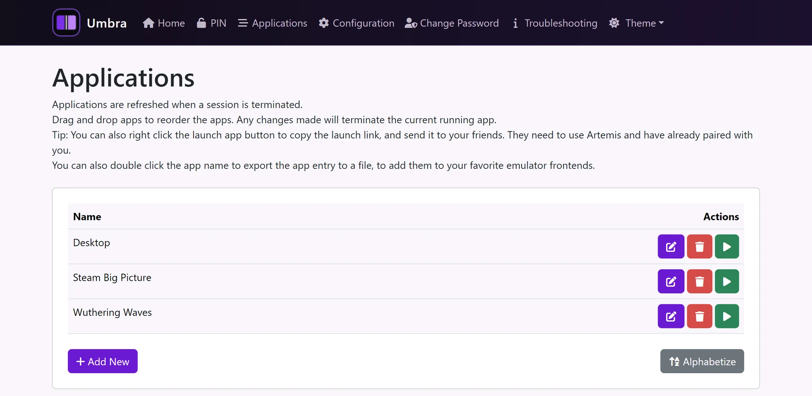
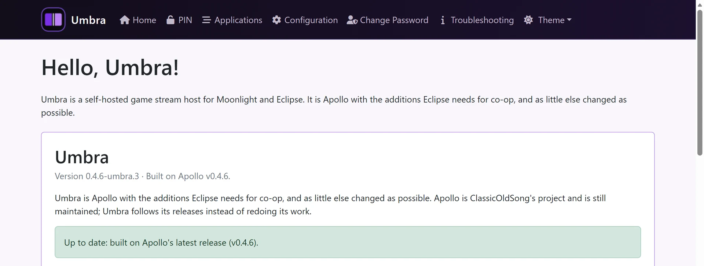

[Project Hub](../README.md) · [Installation Guide](installation.md) · [Eclipse](eclipse.md) · [Umbra](umbra.md) · [Development](development.md) · [Acknowledgements](../ACKNOWLEDGEMENTS.md)

# Umbra · host

## The gaming-PC app.

Stream your games and desktop from a Windows or Linux PC. Umbra is Apollo with the additions Eclipse needs for co-op, and as little else changed as possible.

Umbra’s additions use AI-assisted coding. [About the development process.](development.md#development-process)

[Choose your download](#windows) · [Explore the Project Hub](../README.md) · [Umbra repository](https://github.com/PreceptorOfMagic/Umbra) · [Using Vibepollo? See Umbra (Vibepollo)](#editions)

## Umbra for Windows x64

[Umbra Windows x64 releases](https://github.com/PreceptorOfMagic/Umbra/releases)

Open the latest release, expand Assets and choose the package described below. If no release is listed, that package has not been published.

Choose the Windows x64 installer `.exe` in the latest release’s Assets. Install on each Windows gaming PC, including its bundled virtual-display and device components. Administrator access is needed for installation; no separate device-bridge download is required.

**Already using Apollo?** Umbra and Apollo replace one another; they are not side-by-side installations. Umbra deliberately keeps the Apollo installation folder and registry identity for in-place upgrades. Back up your host configuration and pairings before switching. Installing Apollo again replaces Umbra and removes access to Umbra-specific co-op features.

Windows 11 x64 with NVIDIA RTX 4070 / RTX 3070 and AMD Radeon RX Vega is the current physical test base. Umbra for Linux is a Flatpak (below), tested with KDE Plasma and GNOME on Ubuntu 26.04 and 26.10, Fedora 44 and 45 and openSUSE Tumbleweed on an AMD Radeon RX Vega, and on Ubuntu 26.04 also on an NVIDIA RTX 2060 SUPER. macOS is not a release target.

Download an attached file under **Assets**, not GitHub’s automatically generated **Source code (zip)** or **Source code (tar.gz)**. Those are developer archives, not installable apps. Use the latest compatible stable release. If no package is attached for your platform, that download is not available. [Exact Windows host installation →](installation.md#umbra-windows)

## Umbra for Linux

[Umbra for Linux release](https://github.com/PreceptorOfMagic/Umbra/releases/tag/umbra-linux-v0.5.2)

Open the Umbra for Linux release and expand Assets. If no release is listed, that package has not been published.

Download `Umbra-<version>-linux-x86_64.flatpak` from the Umbra for Linux release and install it with `flatpak install --user`. KDE Plasma and GNOME on Wayland get ordinary streaming, a virtual display for each stream and co-op; X11 desktops get ordinary streaming only. Optional extras add HDR to KDE’s and GNOME’s virtual displays: patches to KWin and Mutter, prebuilt for Ubuntu 26.04 and 26.10, Fedora 44 and 45, openSUSE Tumbleweed, Arch Linux and CachyOS. Testing: Umbra 0.5.2 ran on hardware with an AMD Radeon RX Vega on Ubuntu 26.04 and 26.10, Fedora 44 and 45 and openSUSE Tumbleweed, with KDE Plasma and GNOME, with and without each HDR extra. NVIDIA GPUs and HDR desktop streams were not run with 0.5.2 (0.5.1 was tested on an RTX 2060 SUPER), and Arch Linux and CachyOS are untested on hardware because the test PC cannot start them without changing its Secure Boot setup. The only AMD card tested is a 2017 Radeon RX Vega, whose encoder limits 4K to about 60 fps. [Exact Linux host installation →](installation.md#umbra-linux) · [HDR extras for your distribution →](installation.md#umbra-linux-hdr)

## Umbra.

Umbra comes in two versions: Umbra, built on Apollo, and Umbra (Vibepollo), built on Vibepollo. Both carry the same additions for Eclipse; they differ only in the host they are built on. Choose the one built on the host you would otherwise use.

| | Umbra | Umbra (Vibepollo) |
|---|---|---|
| Built on | [Apollo](https://github.com/ClassicOldSong/Apollo) (ClassicOldSong) | [Vibepollo](https://github.com/Nonary/Vibepollo) (Nonary), itself built on Apollo |
| Platforms | Windows x64, Linux (Flatpak) | Windows x64 |
| Installer | Windows installer `.exe`; Linux Flatpak bundle | Vibepollo’s setup, with its MSI package |
| Replaces in place | Apollo | Vibepollo, Apollo or Umbra, keeping configuration and pairings |
| Status | Released; the tested version | Released (2.0.0-umbra.1) and tested on the project’s test PCs |

Umbra (Vibepollo) keeps everything Vibepollo adds over Apollo as Vibepollo ships it, including its own virtual display and virtual gamepad drivers, and Vibepollo’s RTX HDR support, which uses NVIDIA’s TrueHDR runtime under NVIDIA’s own licence terms. Until code signing is set up, its virtual gamepad driver is signed with Umbra’s own certificate, which the installer adds to the PC’s trusted certificates.

It follows Vibepollo’s releases the way Umbra follows Apollo’s, with the additions kept apart so Vibepollo updates can be merged in. It is an independent fork; [report problems with it to Umbra (Vibepollo)](https://github.com/PreceptorOfMagic/Umbra-Vibepollo/issues/new), not to Vibepollo.

[Umbra (Vibepollo) Windows x64 releases](https://github.com/PreceptorOfMagic/Umbra-Vibepollo/releases)

Open the latest release, expand Assets and choose the package described below. If no release is listed, that package has not been published.

Choose the Windows x64 installer `Umbra-Vibepollo-windows-x64.exe` in the latest release’s Assets.

[Install Umbra (Vibepollo)](installation.md#umbra-vibepollo) · [Umbra (Vibepollo) repository](https://github.com/PreceptorOfMagic/Umbra-Vibepollo)

## Apollo first, focused Umbra additions.

[Apollo, by ClassicOldSong and contributors](https://github.com/ClassicOldSong/Apollo), supplies the everyday host experience, built on Sunshine. Umbra keeps that foundation and adds the host-side encoder, session coordination and integration Eclipse needs. It is not a rewrite of Apollo.

Umbra keeps its additions and branding in separate files wherever possible, so Apollo updates can be merged with fewer conflicts. The aim is to follow Apollo’s development, not replace it; an Apollo update still needs to be integrated and tested in Umbra.

### Versions, updates and help

The Umbra panel in the host’s web interface identifies the installed Umbra build and its recorded Apollo release base. Its update notice compares published releases; it does not prove that every newer Apollo commit has been included. Install Umbra releases to retain Eclipse’s co-op additions.

Apollo resource links lead to Apollo’s own pages. For this fork, [report problems to Umbra](https://github.com/PreceptorOfMagic/Umbra/issues/new/choose), not to Apollo’s maintainers.

## The full host, plus co-op.

### Everyday hosting, from Apollo

- PIN pairing, game/desktop entries and a local web interface.
- Per-client permissions and on-demand virtual displays.
- Hardware encoder selection, resolution/refresh negotiation and supported HDR.
- Low-latency audio, gamepad/keyboard/mouse input and session logs.

### Coordinated with Eclipse

Umbra supplies the custom encoder and capability negotiation needed to make compatible co-op streams across different GPU vendors. Eclipse handles joining the streams, presentation and player assignments.

Co-op defaults are separate from regular streaming. The Co-op Pane is built into Umbra and requested automatically by Eclipse; it is not an entry you need to create in the host’s Applications page. [The complete project and system map →](../README.md#how-it-works)

## After installation

Use the installed host shortcut or tray action to open configuration, set up the local login and approve Eclipse’s pairing PIN. Test one ordinary session from each PC before starting co-op.

[Pair an Eclipse client](installation.md#pairing) · [Compatibility and known gaps](../README.md#status) · [Report a problem](installation.md#diagnostics)

## At the host.

**Apollo foundation, Umbra additions.** The complete host panel, captured on 8 October 2026. Apollo-base status and the published Umbra release check appear separately; both results are shown.

[Eclipse/Umbra licence & notices](../LICENSES.md) · [GPL-3.0](../LICENSE.txt)
